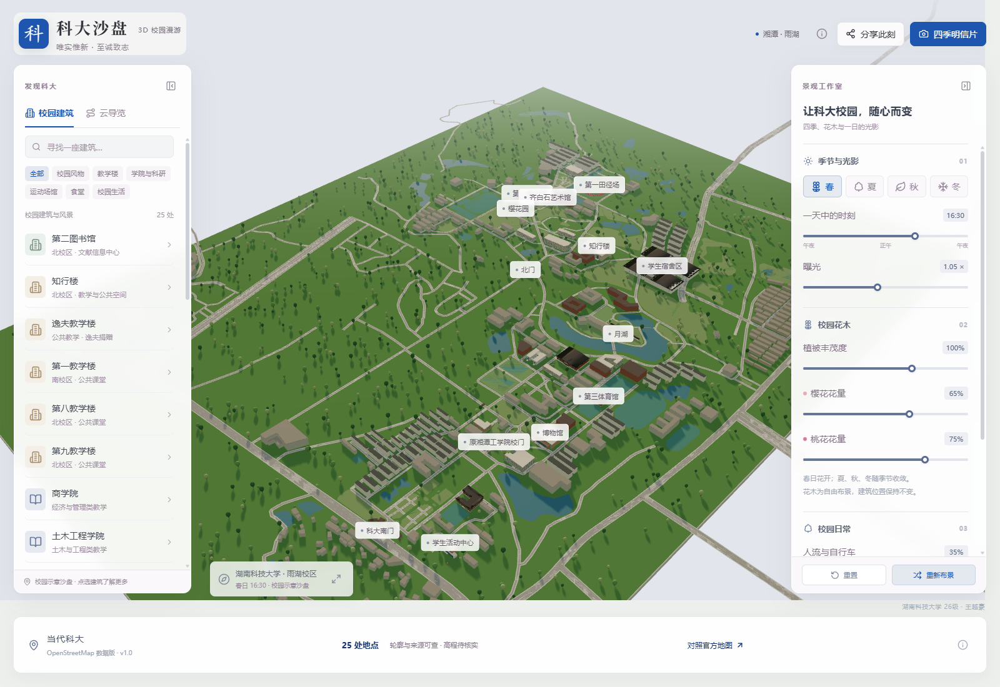
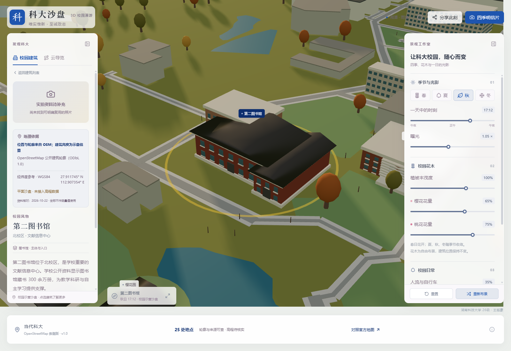
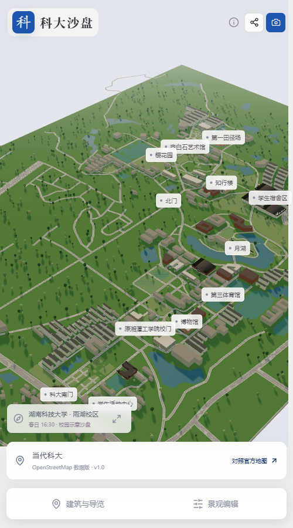
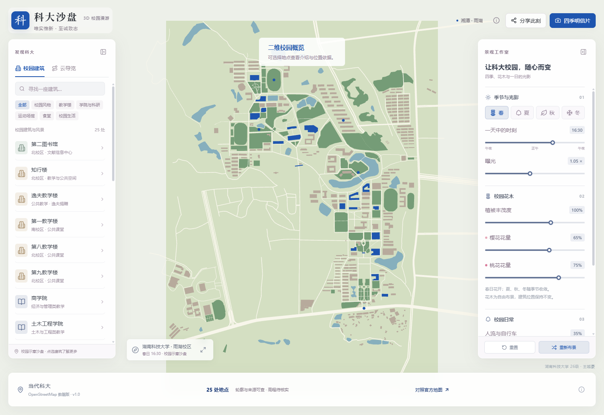

# 科大沙盘 · 湖南科技大学 3D 校园漫游

> 作者：**湖南科技大学 26级 王越豪**

一个湖南科技大学三维校园沙盘。

**在线浏览：https://razoredge-wyh.github.io/hnust-campus-3d/**（GitHub Pages）

做法与风格来自两个学生作品：

- 清华大学的 [清华园境](https://github.com/IvanZhang22/tsinghua-campus-3d)（**MIT 许可**，Vite + React + Three.js + React Three Fiber）
- 奥克兰大学的 [UoA World Model](https://github.com/pengqianhan/campus-world-model)（**MIT 许可**，Preact + Three.js，校园楼层与房间数字孪生）

本项目**直接以「清华园境」的 MIT 源代码为底座照搬改造**：保留其场景、四季光影、导览、搜索、分享与明信片等前端能力，把数据层整体替换为湖南科技大学的 OpenStreetMap 公开数据与校方公开资料，并按科大校色（天蓝）与校训重做视觉与文案。奥克兰项目的「可走进建筑 / 楼层房间」需要学校内部校园地图数据，本科大版暂未包含，作为后续方向。

> 独立作品。建筑高度为示意估算，底图为平面沙盘，不宣称测绘精度；不含实拍照片，不使用学校校徽文件。

## 美术取舍

清华「清华园境」的编辑式沙盘、中文排版、四季与明信片系统更完整，也更适合校园漫游的叙事，因此整体美术沿用清华；
奥克兰项目更偏功能性数字孪生（楼层/房间/可行走），本项目暂未实现其室内部分。
配色使用湖南科技大学标准色**天蓝（C:90 M:5）**与金色点缀，替换清华紫。

## 截图

| 总览 | 地点详情 |
| --- | --- |
|  |  |

| 手机布局 | WebGL 不可用时的二维回退 |
| --- | --- |
|  |  |

## 内容

- **25 处地点**：科大南门、北门、原湘潭工学院校门、月湖、樱花园、第二图书馆、知行楼、
  逸夫教学楼、第一/八/九教学楼、商学院、土木工程学院、外国语学院、生命科学学院、美术楼、
  信息楼、博物馆、齐白石艺术馆、学生活动中心、第三体育馆、第一田径场、南园食府、学生宿舍区、
  工程训练中心，以及月湖/樱花路等景观。
- **343 栋周边建筑**、243 段道路、111 处水系/绿地/运动场地，全部来自 OpenStreetMap。
- 四季与一日光影、植被/花木/人流布景、建筑名称标签、四条自动导览、分类搜索、分享链接、
  四季明信片、二维回退视图（WebGL 不可用时）。
- 中文界面，响应式布局，移动端抽屉面板。
- 历史分期（1949 起点 / 1978 煤炭工科 / 2003 合并组建 / 2016 至今省部共建）来自公开校史资料，
  历史阶段仅作说明，建筑始终按当代示意显示。

## 本地运行

已安装好依赖时：

```bash
pnpm dev        # http://127.0.0.1:5175
pnpm build      # 生产构建到 dist/
pnpm preview    # 预览构建结果
```

Windows 下也可以双击 `start.cmd`（会自动使用系统 Node，找不到时回退到本机 DSH 自带的 Node）。

从零开始：

```bash
pnpm install    # 或 npm install
pnpm dev
```

> 注：pnpm 11 默认拦截依赖的安装脚本。本仓库已通过 `pnpm approve-builds --all`
> 放行 `esbuild`；若在新机器上遇到同类提示，执行一次该命令即可。

## 数据与重建

- 数据文件：`src/data/campus-data.json`，由 `tools/build-data.py` 生成，前端由 `src/data/campus.ts` 读取。
- 原始数据：`hnust_map.osm`，从 OpenStreetMap API 按校园范围导出（2026-10-22 快照）：

  ```
  https://api.openstreetmap.org/api/0.6/map?bbox=112.9000,27.8935,112.9235,27.9185
  ```

- 重建：

  ```bash
  python tools/build-data.py        # 读取 %TEMP%\hnust_map.osm，或设置环境变量 HNUST_OSM
  ```

- 坐标系：米制本地坐标，x 向东、z 向南、y 为高度；中心点 27.9058°N, 112.9116°E。

## 数据来源与许可

| 来源 | 用途 | 许可 |
| --- | --- | --- |
| [OpenStreetMap](https://www.openstreetmap.org/copyright) | 建筑轮廓、道路、水系、绿地、运动场地 | © OpenStreetMap contributors，ODbL 1.0 |
| [湖南科技大学官网](https://www.hnust.edu.cn/) | 校名、校训、学校概况与机构信息 | 事实性引用，版权归学校 |
| [教育部合并组建通知](http://www.moe.gov.cn/srcsite/A03/s181/200304/t20030416_170545.html) | 2003 年两校合并史实 | 政府公开信息 |
| [校训释义](https://news.hnust.edu.cn/kdyw/xwtt/32401.htm) | 「唯实惟新，至诚致志」与标准色 | 事实性引用 |
| [清华园境](https://github.com/IvanZhang22/tsinghua-campus-3d) | 前端代码底座（MIT） | MIT |
| [UoA World Model](https://github.com/pengqianhan/campus-world-model) | 方法参考（MIT） | MIT |

- **代码**：MIT，见 [LICENSE](LICENSE)。上游版权归 IvanZhang22（清华园境）所有；本项目在其基础上
  修改数据与界面，并按 MIT 要求保留原版权声明。
- **数据**：OSM 部分沿用 ODbL 1.0；学校名称与公开资料归湖南科技大学。
- 本项目未使用任何实拍照片、校徽图形或第三方地图瓦片。

## 作者与致谢

- 设计与搭建：湖南科技大学 26级 王越豪
- 美术与代码底座：清华园境（MIT）
- 方法参考：UoA World Model（MIT）
- 数据：OpenStreetMap（ODbL）与湖南科技大学公开资料

## 已知限制

- 建筑高度为按面积/类型的示意估算，地面为平面，未接入高程。
- 校园内的楼名、道路名以 OSM 标注为准（2026 年 10 月快照），可能与现实更新不同步。
- 地标模型为程序化体块，不追求单体的精确复原；没有建筑内部楼层与房间。
- 历史分期仅作办学沿革说明，建筑始终按当代示意显示。

## 上游工程结构（照搬部分）

```
src/scene/        Three.js 场景：静态楼群、树木、花木、人流、灯光、相机
src/ui/           中文界面：建筑列表、导览播放器、景观编辑器、明信片
src/state.ts      可分享场景状态（URL 参数）
src/styles.css    界面样式（已替换为科大天蓝主色）
tools/build-data.py   本项目新增：OSM → 校园数据
```

原项目的 `real-campus.ts`、清华专属照片与 `campus-geometry.json` 已移除，替换为科大数据层。


